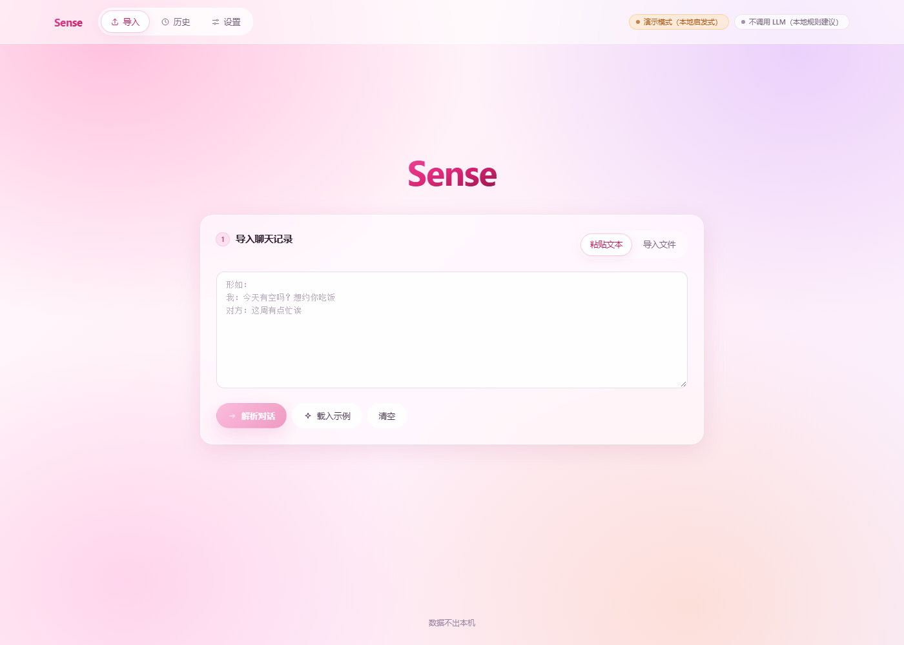
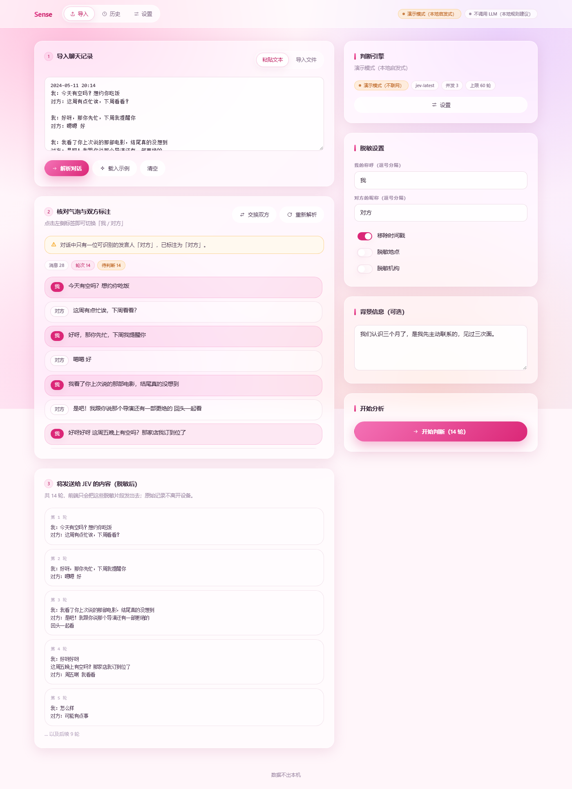
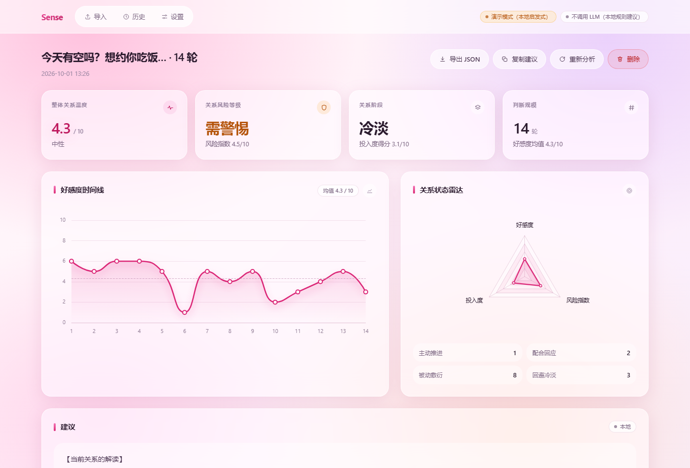
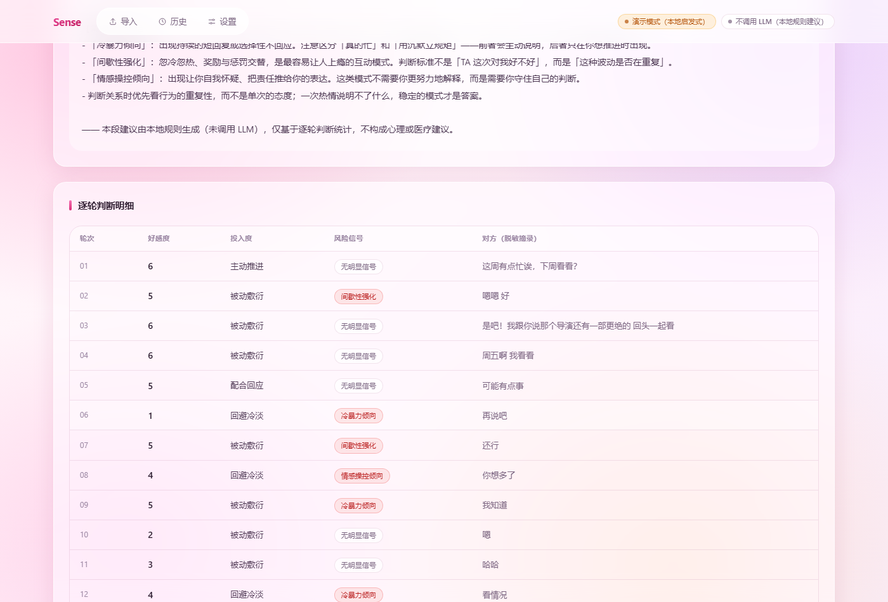

# Sense · 情感判断与建议工具

开源的、**完全本地运行**的情感判断工具。导入聊天记录 → 本地脱敏 → 逐轮 JEV 判断 → 汇总判断 → LLM 生成「接下来该怎么做」的建议。

> **核心承诺**：聊天记录、JEV Key、LLM Key、判断结果都留在你的设备上，不经过任何中间服务器。原始聊天文本永远不会被写入本地存储，也永远不会被发送出去。

---

## 快速开始

```bash
npm install          # 或 pnpm install
npm run dev          # 网页版：http://localhost:5173
npm run desktop      # 桌面版（Windows）：build + 打开窗口，不需要代理
npm run proxy        # 可选：网页版需要时的本地 CORS 代理
npm test             # 单测 / 端到端 / DOM 冒烟测试
npm run build        # 类型检查 + 生产构建到 dist/
npm run preview      # 预览构建产物
```

**需要自己准备模型**：Sense 不内置任何演示数据或本地启发式兜底 —— 判断与建议都来自你自己配置的模型，拿不到模型输出就如实报错，不会用模板编一个看起来像结论的东西出来。

首次使用四步：

1. 打开「设置」，配好 **JEV 判断引擎**（默认 TypeSafe）与 **建议生成（LLM）**，填 Key，各点一次「测试连接」确认连通。
2. 打开首页 → 点「载入示例」或粘贴自己的聊天记录 → 点「解析对话」。
3. 核对气泡的「我 / 对方」标注（点标签即可切换，或用「交换双方」一键翻转）→ 右侧按需打开地点/机构脱敏。
4. 点「开始判断」→ 结果页查看标签、数字、时间线图与雷达图；**建议按需生成** —— 点建议卡片右上角的「生成建议」才会调用 LLM。

JEV 引擎已预填官方地址 `https://api.typesafe.ai/v1/systemone` 与模型 `jev-latest`，换成 OpenAI 兼容亦可。

测试请求被压到最小：**JEV 只发 1 个「2 档 score」问题**（请求体 126 字节，约是完整一轮判断的 1/9），**LLM 只发一句 `hi` 并限制 `max_tokens: 1`**。成功时只显示「连接正常 · 耗时」，不展示任何判断结果；失败时给出可读原因（HTTP 状态、缺项、配置缺失、CORS、网络错误），20 秒超时。

测试通过后，**右上角对应的模型标记会变绿**（悬停可看耗时）。这个绿色严格表示「本次会话里这一侧刚验证通过」：

- 只影响被测试的那一侧 —— 测 JEV 不会让 LLM 那一侧变绿；
- 改动任何相关配置（引擎 / Base URL / Path / 模型 / 代理，或 API Key 的有无）后**立即失效**，回到中性色；
- 测过但失败变红；没测过是中性色（不会拿「已配置」冒充「已验证」）；
- **不持久化**：刷新页面回到「未验证」—— 把一次测试通过永久记下来会误导人。

---

## 本地 CORS 代理

浏览器是否允许网页直连某个 API，**取决于对方有没有返回 `Access-Control-Allow-Origin`**，跟你的代码无关。实测下来两类目标差别很大：

| 目标 | 浏览器直连 | 实测 |
| --- | --- | --- |
| **DeepSeek 官方 API** | ✅ 可以，**不需要代理** | 预检 `200`，回 `Access-Control-Allow-Origin: http://localhost:5173` |
| **TypeSafe（`api.typesafe.ai`）** | ❌ 不行，必须走代理 | 预检 `400`，不带该响应头 |
| 本地 Ollama | ✅ 可以 | 同机服务，默认允许本地来源 |

需要代理时，Sense 自带一个只监听本机回环地址的代理，把请求改从本机进程发出（服务端到服务端没有 CORS）：

```bash
npm run proxy        # 终端 A：启动代理（http://127.0.0.1:8787）
npm run dev          # 终端 B：启动前端
```

然后在 **设置 → 网络代理** 打开开关即可（设置页会显示改写后的实际请求地址，便于排查）。

- **数据路径**：浏览器 → 你自己机器上的代理 → 你选的 API。没有第三方中间服务器；代理不落盘、不记录请求内容，只把状态码和耗时打到控制台。
- 代理只监听 `127.0.0.1`，且只接受本机来源（`localhost` / `127.0.0.1`），避免变成任意网站可用的开放代理。
- 如果 `dist/` 存在，代理会**顺便托管它**：直接打开 `http://127.0.0.1:8787` 就是同源，连 CORS 都不需要。
- 端口可用 `SENSE_PROXY_PORT` 覆盖。

以 TypeSafe 为目标时的对照（用假 Key）：

| 场景 | 结果 |
| --- | --- |
| 网页直连 | `TypeError: Failed to fetch`（被 CORS 拦下） |
| 走本机代理 | `HTTP 401` + TypeSafe 的真实鉴权错误体（说明请求确实到达了上游） |

> 桌面版不受 CORS 限制，也不需要代理（见下面的 [桌面版](#桌面版windows)）。

## 桌面版（Windows）

Electron 壳，直接复用 Web 产物，**不需要起本机代理**：

```bash
npm run desktop        # 先 build，再打开桌面窗口
npm run desktop:dev    # 另开终端先跑 npm run dev，窗口指向 dev server
```

它不是"把网页塞进浏览器窗口"就完事 —— 关键在于**请求的发出位置**：

| | 网页版 | 桌面版 |
| --- | --- | --- |
| API 请求由谁发出 | 浏览器渲染进程 | **主进程（Node）** |
| CORS 约束 | 有，取决于对方响应头 | **没有这个机制** |
| 需要 `npm run proxy` | 视目标而定 | **不需要** |
| `webSecurity` | 正常 | **正常**（没有为了绕 CORS 而关掉同源策略） |

实现方式是渲染进程通过 preload 暴露的**单一受限通道**（`window.senseDesktop.request`）把请求交给主进程：

```
渲染进程 postJson() → preload(contextBridge) → ipcRenderer.invoke → 主进程 fetch → 上游 API
```

- `contextIsolation: true`、`nodeIntegration: false`，preload 只暴露 `request` / `abort` 两个方法，不暴露 `ipcRenderer` 本身。
- 保留超时与**取消**：分析页的「取消」会通过 `sense:http-abort` 中断主进程里对应的请求。
- 外链一律交给系统浏览器打开，不在应用窗口内导航。
- 浏览器里仍然走原生的 `fetch`，所以网页版行为完全不变（`postJson` 里只加了一个分支）。

### 打包（Windows 安装包）

```bash
npm run package:win     # 一次产出三种形态：
                        #   release/Sense-Setup-0.1.0.exe     NSIS 安装包（可选目录/建快捷方式）
                        #   release/Sense-Portable-0.1.0.exe  免安装单文件
                        #   release/Sense-0.1.0-win.zip       解压即用，不经过 NSIS
npm run icon            # 需要改图标时重新生成 build/icon.ico
```

- **安装包**：可选安装目录、建桌面与开始菜单快捷方式（`oneClick: false`，不是静默一键装）。
- **portable**：单个 exe，双击即用，适合不装东西的场景。
- **zip**：把解压出来的目录当成绿色版，双击里面的 `Sense.exe` 即可。**NSIS 类的安装包如果被安全软件拦截（见下方排查），用这个最稳**。
- 图标由 `tools/make-icon.py` 生成（Pillow，玫粉渐变圆角方块 + 白 S，取色自 `accent-400 → accent-600`）。
- **包体**：`app.asar` 只有 **1.35 MB / 11 个文件**（`dist/` + `desktop/` + `package.json`）—— 前端依赖已被 Vite 打进 `dist/`，主进程只用 Electron 与 Node 内置模块，所以整个 `node_modules` 都排除掉了（不加这条排除规则会多出 1300 多个文件）。安装包 ~106 MB，其中绝大部分是 Electron 运行时本身。

> 想要更小的体积可以换 Tauri（Rust 工具链 + WebView2 机器上都已具备，产物约 5 MB），代价是请求要另走 Rust 侧通道、且需要重写这一层。

> **产物不进版本库**：`release/` 已被 `.gitignore` 忽略 —— 安装包 106 MB、zip 146 MB 都超过 GitHub 的 100 MB 单文件硬限制，直接提交会推送失败。分发给用户请走 **GitHub Releases**。
>
> Android 的 `local.properties` 同样被忽略：它记录本机 SDK 绝对路径，会把用户名一起带上去。`build/icon.ico` 则例外地**要**提交 —— electron-builder 打包时需要它（`build/*` 忽略后再用 `!build/icon.*` 放行）。

**排查**

- 启动即退出、报 `require("electron") 返回的不是应用模块` → 环境里有 `ELECTRON_RUN_AS_NODE`，Electron 退化成了纯 Node。清掉它即可（`main.cjs` 会直接给出这条提示）：`Remove-Item Env:ELECTRON_RUN_AS_NODE`。
- 报 `Process failed to launch` 或原生崩溃（`0xC0000005`）→ 当前会话没有可用的窗口站（无交互桌面、服务会话、部分 CI）。正常登录的桌面会话不会遇到这种事。
- 首次 `npm install` 时 Electron 二进制从 GitHub 下载失败（`fetch failed`）→ 国内网络常见，换镜像重下：
  ```bash
  ELECTRON_MIRROR=https://npmmirror.com/mirrors/electron/ node node_modules/electron/install.js
  ```
- 打包时报 `EPERM: rename 'release\win-unpacked.tmp' -> 'release\win-unpacked'` → 那个临时目录被占用了（杀毒软件扫描刚解压出来的 `electron.exe`、或目录被监视）。绕过办法是预先解压 Electron，让 electron-builder 跳过「解压 + 改名」这一步：
  ```bash
  # 1) 找到缓存的 zip 并解压到 .electron-dist
  tar -xf "%LOCALAPPDATA%\electron\Cache\<hash>\electron-v44.5.1-win32-x64.zip" -C .electron-dist
  # 2) 用带 electronDist 的本地配置打包（electron-builder.local.yml 已备好）
  npx electron-builder --win --config electron-builder.local.yml
  ```
- electron-builder 下载 NSIS / 7zip 工具链失败 → 同样换镜像：`ELECTRON_BUILDER_BINARIES_MIRROR=https://npmmirror.com/mirrors/electron-builder-binaries/`
- 运行安装包报 **`NSIS Error: Error writing temporary file. Make sure your temp folder is valid.`** → 安装包本身没问题（先核对 `Get-FileHash` 与自己构建时一致），常见原因是**安全软件拦截未签名安装包往 `%TEMP%` 释放文件**，或安装包被以其他用户/管理员身份运行导致 TEMP 不可写。按顺序试：
  1. **直接用 zip 版**（`Sense-0.1.0-win.zip`）—— 完全不走 NSIS，解压即用，这是最稳的路径；
  2. 右键安装包 → 属性 → 勾选「解除锁定」；
  3. 在安全软件里把 `Sense-Setup-*.exe` 与 `%TEMP%` 加入白名单，再双击运行（不要「以管理员身份运行」）；
  4. 确认 `echo %TEMP%` 指向的目录真实存在且可写。

## Android 版

Kotlin + Jetpack Compose 宿主 + WebView，复用**同一份** `dist/` 产物。和桌面版是同一个架构决定：**请求由原生侧发出**，所以没有 CORS 问题。

```bash
npm run build                     # 先生成 dist/
cd android && ./gradlew assembleDebug
# → app/build/outputs/apk/debug/app-debug.apk
```

`app/build.gradle.kts` 里的 `syncWebAssets` 任务会把仓库根的 `dist/` 同步进 assets，不存在"手工拷一遍、两边不一致"的问题。

| | 网页版 | Android 版 |
| --- | --- | --- |
| Web 资源来源 | Vite dev server / 静态托管 | **assets/www/**，经 `WebViewAssetLoader` 挂在 `https://appassets.androidplatform.net/assets/www/` |
| API 请求由谁发出 | 浏览器 WebView | **原生 OkHttp** |
| CORS | 有 | **没有这个机制** |
| 需要 `npm run proxy` | 视目标而定 | **不需要** |

实现要点：

- **为什么不用 `file://`**：`file://` 的源是 opaque 的，`localStorage` 等行为与浏览器不一致。用 `WebViewAssetLoader` 挂在一个正常的 https 源下，行为与网页版对齐。
- **桥接**：`assets/bridge.js` 把原生 JS 接口包装成 Promise，暴露 `window.senseDesktop` —— 与 Electron 桌面壳**完全同一套接口**，所以 `postJson` 那个分支一行都不用改，移动端与桌面端共用。
- **取消**：`senseDesktop.abort(id)` → `SenseBridge.abort()` → OkHttp `Call.cancel()`，并让错误信息带上 `Aborted` 以匹配前端的 `/abort/i` 判断。
- **返回键**先走 WebView 历史；外链交给系统浏览器。
- `minSdk 26`、`targetSdk 36`、`compileSdk 37`（Compose 1.12 / OkHttp 5 要求 ≥37；targetSdk 停在 36 是不想抢先跟进未验证的运行时行为变更）。

**实测**（Android 36.1 模拟器，`Medium_Phone_API_36.1`）：应用启动稳定、Web UI 完整渲染、设置页点「测试连接」拿到 TypeSafe **真实服务端响应**：

```
连接失败
HTTP 403 - {"detail":{"error_type":"authentication_error",
            "message":"Must supply an API key! Check your request and try again."}}
```

这正是要证明的东西 —— 同样的请求在浏览器里会被 CORS 拦下（网页版要起代理），在 Android 上直接到达了上游。

> 目前交付的是 **debug APK**（可直接安装）。发布版需要自签名：
> `keytool -genkeypair -keystore sense-release.jks -alias sense -keyalg RSA -validity 10000`，
> 然后在 `app/build.gradle.kts` 里配 `signingConfigs.release` 并跑 `./gradlew assembleRelease`。
> 签名文件与口令不要进版本库。
>
> 纯原生重写（Compose 重做全部界面、Kotlin 重写 JEV 流水线）是另一个量级的工作，不在当前范围内 —— 上面这套的意义是**逻辑单一来源**，改 Web 端即全平台生效。

## 功能状态

| 优先级 | 功能 | 状态 |
| --- | --- | --- |
| P0 | 文本粘贴 + 逐轮 JEV 判断 | ✅ |
| P0 | 汇总判断（逐轮结果 → 整体结论） | ✅ |
| P0 | 标签 + 数字展示 | ✅ |
| P0 | 本地脱敏预处理（昵称/时间戳/PII） | ✅ |
| P1 | 时间线图 + 雷达图（ECharts） | ✅ |
| P1 | 建议生成（用户自带 LLM Key，结果页按需触发） | ✅ |
| P1 | 历史记录（localStorage） | ✅ |
| P2 | 消息记录文件解析 | ✅ 带时间戳的 TXT（一行式 / 两行式，含 `昵称<邮箱>` / `昵称(号码)`）、带 `isSend` 的 JSON（方向明确）、通用 JSON / CSV / TSV |
| P2 | 桌面版（Windows / Electron） | ✅ 复用 Web 产物；API 请求走主进程，**不需要 CORS 代理**；已可打包成 NSIS 安装包与免安装单文件 |
| P2 | Android（Kotlin + Compose + WebView） | ✅ 复用同一份 Web 产物；API 请求走 OkHttp，**不需要 CORS 代理**；已在 API 36 模拟器上实测通过 |
| P2 | Tauri 壳、纯原生 Android 重写 | ⬜ 未开始；Web 产物用相对路径（`base: './'`），可直接复用 |

---

## 数据流与隐私

| 环节 | 数据位置 | 是否离开设备 |
| --- | --- | --- |
| 聊天记录解析 | 本地 | 否 |
| 脱敏处理 | 本地 | 否 |
| 逐轮 JEV 判断 | 客户端直调你的 TypeSafe / 兼容接口 | 仅脱敏片段 |
| 汇总判断 | 客户端直调 | 仅判断结果（不含原始对话） |
| 建议生成 | 客户端直调你的 LLM | 汇总结果 + 脱敏摘要 + 你填的背景 |
| 结果存储 | `localStorage` | 否 |

工程上的保证：

- 消息对象同时持有 `raw`（原始）与 `clean`（脱敏）两份文本，**只有 `clean` 会进入请求体**；`raw` 只在当前页面内存中存活。
- 写入历史记录前，`sanitizeForStorage()` 会把每个气泡的 `raw` 置空（`src/store/history.ts`），所以 localStorage 里不存在原始聊天文本。
- API Key 存在独立的 `sense.secrets.v1` 键下，可以在设置页关掉「在本机记住 API Key」，此时 Key 只存活在本次会话内存中。
- 导出的 JSON 也只包含脱敏文本与判断结果。
- 结果页的「脱敏摘要」区块展示的就是发给 LLM 的**全部**内容，可自行审计。

### 脱敏规则

| 规则 | 行为 |
| --- | --- |
| 对方昵称 | → `对方`（解析时自动补充检测到的标签，也可手动填写） |
| 自己的称呼 | → `我` |
| 时间戳 | 开关控制，默认移除（`2024-05-11 20:14`、`上午10:23`、`5月11日`…） |
| 地点 / 学校 / 公司 | 开关控制，默认关闭（本地正则 + 常见城市词表，可能过杀） |
| 手机号 / 邮箱 / 证件号 / 银行卡 / 链接 | **始终**替换，不受开关影响 |
| 独特口头禅 | **故意保留** —— 它们影响判断准确度 |

---

## 判断口径

逐轮（一次请求同时问三个问题，见 [适配协议](docs/adapter-protocol.md)）：

- **好感度**（score 0-10）：明显反感 → 冷淡敷衍 → 中性礼貌 → 友好积极 → 明显好感 → 热烈喜欢
- **投入度**（choice）：主动推进 / 配合回应 / 被动敷衍 / 回避冷淡
- **风险信号**（choice）：无明显信号 / 冷暴力倾向 / 情感操控倾向 / 间歇性强化 / 暧昧不承诺

汇总（只输入结构化统计，不重新喂原始对话）：

- **整体关系温度**（score 0-10）
- **关系风险等级**（choice）：健康 / 需观察 / 需警惕 / 高风险
- **关系阶段判断**（choice）：初识 / 升温 / 稳定 / 冷淡 / 疏远

展示层的派生分数：

- 投入度得分 = 加权平均（主动推进 10、配合回应 6.5、被动敷衍 2.5、回避冷淡 0）
- 风险指数 = 加权平均（无明显信号 0、暧昧不承诺 5.5、冷暴力/间歇性强化 8、情感操控 10）

「一轮」的定义：我方一条（或连发的多条合并）＋ 对方一条回复。对方先开口的那一轮会作为独立一轮参与判断；我方末条无人回复时标记为「对方未回复」，不参与判断。

---

## 消息记录文件解析（P2）

`src/core/import/formats.ts` 统一把各种文件格式转成「昵称：内容」文本，再交给常规解析。识别顺序与支持范围：

| 格式 | 判定依据 | 方向处理 |
| --- | --- | --- |
| 带时间戳的 TXT（一行式） | `2023-05-11 20:14:03 昵称` 或 `昵称 2023-05-11 20:14:03` | 保留昵称，界面可一键交换 |
| 带时间戳的 TXT（两行式） | 昵称独占一行 + 时间独占一行（出现 ≥2 次才认定） | 同上 |
| 昵称带后缀 | `昵称<邮箱>` / `昵称(号码)` + 时间 | 同上 |
| JSON（带方向） | 记录里有 `isSend` / `isSelf` 等字段 | **直接判定我 / 对方**，不需要猜 |
| 通用 JSON / CSV / TSV | `sender`+`text` 等常见键名（含 `talker`、`strContent` 等导出工具字段） | 保留昵称 |

表头匹配会统一小写，所以 `isSend`、`strContent` 这类 camelCase 列名也能识别；同时要求表头「真的像表格」才走 CSV 分支，避免把含逗号的普通消息切开。

## 技术栈

React 19 · TypeScript · Vite 6 · Tailwind CSS 4 · ECharts 5 · React Router 7 · Vitest 3；桌面版为 Electron（复用同一份 Web 产物）。无后端，无遥测。

## 设计风格

粉白毛玻璃（Pink & White Glassmorphism）：粉白渐变画布上的白色半透明模糊卡片，深梅色文字，玫粉强调色。全部由 `src/index.css` 的设计 token 驱动。









- **首页只保留导入窗口**：居中 Hero 只有「Sense」标题 + 唯一一个玻璃卡片，其余卡片在解析完成后才出现 —— 交互路径和 DeepSeek 首页一样是「一个输入面 → 展开工作区」。
- **文案克制**：界面里不出现实现细节 —— 协议、模型、存储、数据流向都不在 UI 上解释，只保留必要的功能标签、短提示与错误告警（技术说明统一收在这份 README 里）。导航左上角只有「Sense」，页脚只有「数据不出本机」。
- **背景**：四层大而柔的径向光斑（粉 / 淡紫 / 蜜桃）叠在 135° 线性渐变上（`#fffafd → #fff2f8 → #fdeef9 → #f8f0ff`），`background-attachment: fixed`。没有渐变就没有玻璃可言，所以背景绝不是纯色。
- **玻璃卡片**：浅色底上靠「更白」显形 —— `rgba(255,255,255,.55)` + `backdrop-filter: blur(20px) saturate(150%)` + `1px solid rgba(255,255,255,.75)` 亮边 + `0 8px 32px rgba(196,120,160,.2)` 粉调柔阴影，圆角 20px。
- **文字**：深梅色五档（`#2b1b2e` / `#4a3550` / `#7a6480` / `#9b87a3` / `#b9a8c0`）。**刻意不用纯黑** —— 纯黑压在粉色玻璃上会显脏、发死（浏览器实测页面上纯黑文字数为 0）。
- **按钮**：玻璃胶囊（`blur(14px)` + 白色半透明 + 亮边，hover 变白并抬升 1px）；主按钮是玫粉渐变 + 粉调投影，在浅底上层级最强。
- **输入框**：白色半透明玻璃 + 内亮边，聚焦时亮边转粉 + 粉色光晕。
- **标签 / 徽章**：玻璃胶囊；语义色用较深的色阶（`#047857` / `#b45309` / `#b91c1c`）配浅色底，保证浅色背景上的对比度。
- **图表**：玫粉发光曲线 + 渐变面积、深梅色数值、粉调半透明网格；均值参考线只保留虚线、数值放在卡片头部避免裁切；tooltip 也是白色玻璃。
- **占比**：玻璃元素克制在 60% 以内，其余留给渐变呼吸感。
- **配色同步**：token 集中在 `src/index.css` 的 `@theme`（`canvas` / `surface` / `line` / `ink-*` / `accent-*` / `good|warn|bad-*`）。ECharts 在 canvas 内绘制、读不到 CSS 变量，因此 `src/components/charts/Charts.tsx` 顶部同步了一份同值常量 —— 这是唯一需要两处维护的地方。


## 目录结构

```
src/
  adapters/           # JEV 适配层：typesafe / openai 兼容 + 响应归一化
  core/
    jev/questions.ts  # 逐轮与汇总的 questions（与 spec 一致）
    import/formats.ts # 导出文件格式适配：带时间戳的 TXT / JSON / CSV / TSV（P2）
    preprocess/       # 气泡分割、我方/对方标注、轮次合并、脱敏
    pipeline/         # 汇总统计、脱敏摘要、prompt、建议生成、主流水线
  components/         # UI 基础件 + 图标 + ECharts 封装
  pages/              # 导入页 / 结果页 / 历史页 / 设置页
  store/              # 设置、Key、历史的本地存储 + 会话级连接测试状态
  test/               # 测试用的假模型服务（伪造服务端，不是伪造适配器）
  data/sample.ts      # 内置示例对话
desktop/              # Electron 桌面壳：main.cjs（主进程 + 请求通道）、preload.cjs
tools/cors-proxy.mjs  # 网页版可选的本机 CORS 代理
docs/adapter-protocol.md
docs/screenshots/     # 界面截图
```

## 测试

```bash
npm test
```

覆盖：脱敏规则、气泡分割与轮次合并、发言人标注与交换、时间戳/媒体/系统消息、导出文件格式解析（带时间戳的 TXT / JSON / CSV / TSV）、响应归一化（裁剪/容错/缺项抛错）、TypeSafe 请求格式与分数档位映射、代理 URL 改写、**桌面请求通道（桥注入 / 取消 id 对齐 / 主进程转发）**、设置迁移、连接探测、汇总统计、端到端流水线（含单轮失败降级与全失败报错、`maxRounds` 截断）、建议按需生成与写回历史，以及 jsdom 下的 App 与结果页渲染冒烟测试。

## 已知限制

- **浏览器 CORS 限制**：能不能直连取决于对方是否返回 `Access-Control-Allow-Origin`。实测 **DeepSeek 可以直连**、**TypeSafe 不行**（预检 `400`）。需要时用 [本地 CORS 代理](#本地-cors-代理)；设置页的「测试连接」遇到 CORS 时会直接说明并指出开关在哪，而不是丢一句 `Failed to fetch`。
- **必须自备模型**：没有演示模式，也没有本地规则兜底。未配置或调用失败时会直接报错，不会给出编造的结论。
- 汇总判断失败会让整次分析报错（逐轮结果也会一起丢弃）——这是刻意的取舍：与其展示一个残缺的结果页，不如明确失败后重跑。
- 导出文件的发言人方向在没有 `isSend` 一类字段时无法自动判定，只能按出现顺序假设 + 界面「交换双方」兜底。
- 地点/机构脱敏是正则启发式，可能有误伤或漏网；建议配合开关与人工核对。
- ECharts 打包后约 1 MB（已单独分包为 `charts` chunk），不影响首屏。
- 判断结果不构成心理或医疗建议；若对话中出现持续的操控、贬低或冷暴力模式，请优先照顾自己并寻求现实支持。
